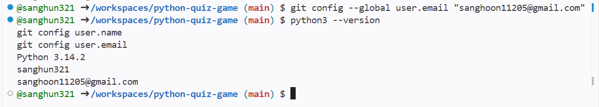
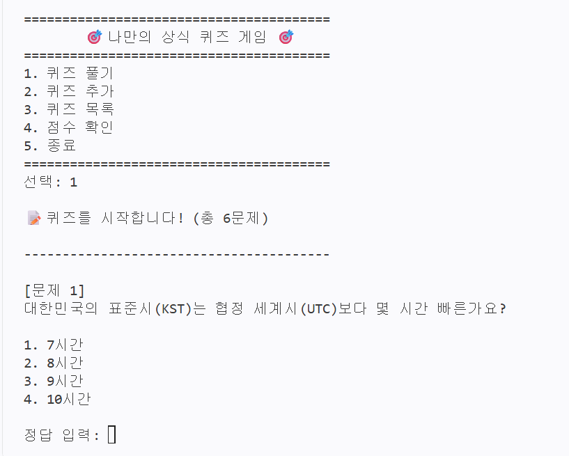
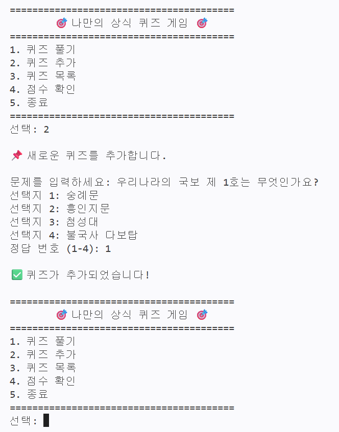
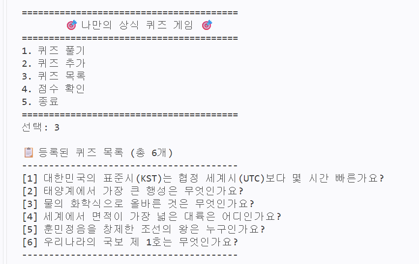
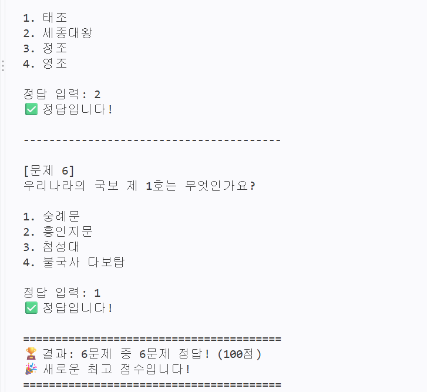
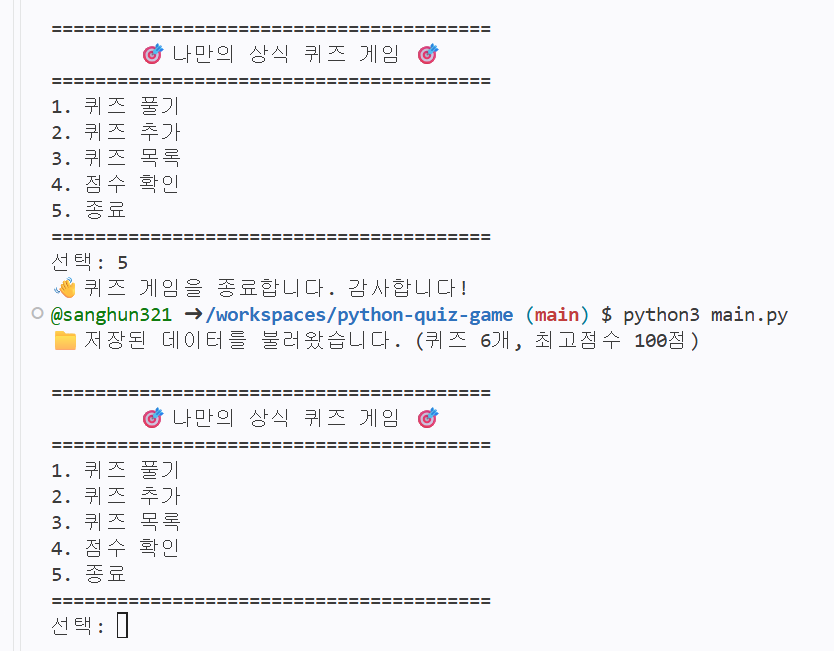
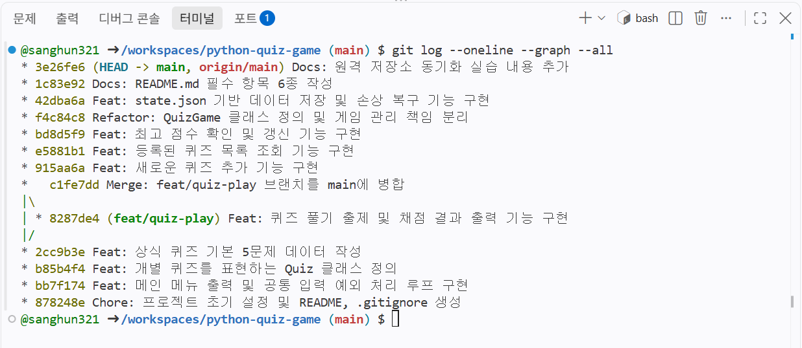

# 나만의 상식 퀴즈 게임 (Python Console Quiz)

## 1. 프로젝트 개요
Python 3.10 이상 환경에서 외부 라이브러리 없이 표준 라이브러리(`json`)와 객체지향 클래스 구조(`Quiz`, `QuizGame`)만을 활용하여 구현한 터미널 기반 콘솔 퀴즈 프로그램입니다. JSON 파일을 통해 프로그램 종료 후에도 추가된 퀴즈와 최고 점수가 유지되도록 데이터 영속성을 구현했습니다.

## 2. 퀴즈 주제 선정 이유
누구나 부담 없이 참여해 직관적으로 문제를 풀고 정답 여부를 즉시 확인할 수 있도록 **일반 상식(지리·과학·역사·표준시 등)**을 주제로 선정했습니다. 또한 사용자가 새로운 상식 문제를 자유롭게 등록하며 나만의 문제 은행으로 확장하기에도 가장 적합한 주제입니다.

## 3. 실행 방법
Python 3.10 이상이 설치된 터미널 환경에서 프로젝트 루트 경로로 이동한 뒤 아래 명령어를 실행합니다.

```bash
python3 main.py
```


*▲ Python 3.14.2 버전 및 Git 사용자 계정(sanghun321) 설정 확인 화면*

## 4. 기능 목록
- **1. 퀴즈 풀기**: 저장된 모든 문제를 순차 출제하고, 사용자 입력과 정답을 비교해 정오답 및 최종 점수(100점 만점 환산)를 출력합니다.

- **2. 퀴즈 추가**: 새로운 문제, 4개의 선택지, 정답 번호(1~4)를 입력받아 퀴즈 목록에 추가하고 즉시 저장합니다.

- **3. 퀴즈 목록**: 현재 등록된 전체 퀴즈 개수와 번호별 문제 목록을 조회합니다.

- **4. 점수 확인**: 지금까지 달성한 최고 점수를 확인하며, 아직 플레이 기록이 없는 경우 안내 메시지를 출력합니다.

- **5. 데이터 영속성 및 예외 처리**:
  - `state.json`을 통해 퀴즈 목록과 최고 점수를 자동 저장·복원하며, 파일 누락 또는 손상 시 기본 5문제로 자동 복구합니다.
  - 공백 입력, 빈 입력(Enter), 문자 입력(`abc`), 범위 밖 숫자 및 `Ctrl+C` / `EOFError` 발생 시 비정상 종료 없이 안전하게 처리합니다.
  

## 5. 파일 구조
```text
python-quiz-game/
├── main.py        # 프로그램 진입점 (QuizGame 실행)
├── quiz.py        # 개별 퀴즈 표현(Quiz 클래스) 및 기본 상식 퀴즈 5문제 데이터
├── game.py        # 메뉴 제어, 게임 진행, 입력 검증, JSON 입출력 관리(QuizGame 클래스)
├── state.json     # 퀴즈 목록 및 최고 점수 영속 저장 파일
├── .gitignore     # Python 캐시 및 불필요한 환경 파일 제외 설정
└── README.md      # 프로젝트 문서
```

## 6. 데이터 파일 설명 (`state.json`)
- **경로**: 프로젝트 루트 디렉토리 (`./state.json`)
- **역할**: 사용자가 추가한 퀴즈 목록과 최고 점수를 UTF-8 인코딩 JSON 형식으로 영구 저장하고 프로그램 재시작 시 불러옵니다.
- **스키마 구조**:
```json
{
  "quizzes": [
    {
      "question": "문제 내용 (str)",
      "choices": ["선택지1", "선택지2", "선택지3", "선택지4"],
      "answer": 1
    }
  ],
  "best_score": 100
}
```

- 원격 저장소 clone 및 pull 동기화 검증 완료

## 7. 최종 검증 완료 내역

**원격·로컬 동기화 완료**
```text
원격·로컬 동기화 완료: 최상단 커밋 3e26fe6에 (HEAD -> main, origin/main)이 함께 표시되어 로컬과 GitHub 원격 저장소가 완전히 일치합니다.
```
**커밋 이력 충족**
```text
초기 설정(878248e)부터 원격 동기화(3e26fe6)까지 총 13개의 의미 있는 커밋이 명확한 메시지 규칙으로 기록되었습니다.
```
**브랜치 분기 및 병합 확인**
```text
feat/quiz-play 브랜치(8287de4) 생성 후 main 브랜치로 병합(c1fe7dd)된 그래프 구조가 한눈에 확인됩니다.
```


---

## 8. Git 커밋 규칙 및 메시지 템플릿
- **커밋 단위 규정 (Atomic Commit)**: **1개의 논리적 기능 또는 작업 단위를 1개의 커밋**으로 분리하여 기록합니다. 클래스 정의, 메뉴 구성, 기능 구현, 예외 처리, 리팩토링, 문서화를 각각 독립된 커밋으로 관리해 변경 이력 추적과 특정 기능 단위 롤백이 가능하도록 구성했습니다.
- **커밋 메시지 템플릿**: `<Type>: <변경 내용 요약>` 형식을 따릅니다.
  - `Feat`: 새로운 기능 구현 (예: `Feat: 새로운 퀴즈 추가 기능 구현`)
  - `Fix`: 오류 및 예외 처리 수정
  - `Refactor`: 기능 동작을 유지한 채 클래스·모듈 구조 개선 (예: `Refactor: QuizGame 클래스 정의 및 게임 관리 책임 분리`)
  - `Docs`: `README.md` 및 실행 증빙 문서 작성 (예: `Docs: README.md 필수 항목 6종 작성`)
  - `Chore`: 초기 프로젝트 및 `.gitignore` 환경 설정 (예: `Chore: 프로젝트 초기 설정 및 README, .gitignore 생성`)
  - `Merge`: 기능 브랜치(`feat/quiz-play`) 검증 후 `main` 브랜치 병합

## 9. 객체지향 클래스 설계 이유 (추상화 및 재사용성)
- **`Quiz` 클래스 (`quiz.py`)**:
  - **추상화 및 캡슐화**: 개별 퀴즈의 문제(`question`), 선택지(`choices`), 정답(`answer`) 데이터와 출력(`display()`), 채점(`check_answer()`), 직렬화(`to_dict()`, `from_dict()`) 동작을 하나의 객체로 추상화했습니다. 덕분에 외부 모듈(`QuizGame`)은 내부 딕셔너리 키 구조나 인덱스 계산 방식을 몰라도 메서드 호출만으로 문제를 출제하고 채점할 수 있습니다.
  - **재사용성 사례**: 콘솔 UI 외에 웹 API(FastAPI/Flask)나 GUI 앱으로 확장하더라도 `Quiz` 모델 클래스와 JSON 변환 메서드를 코드 수정 없이 그대로 재사용할 수 있습니다.
- **`QuizGame` 클래스 (`game.py`)**:
  - **책임 분리 및 추상화**: 메뉴 제어, 입력 검증(`get_valid_int`, `get_non_empty_str`), 점수 산출, 파일 영속성(`load_state`, `save_state`)을 전담하여 진입점인 `main.py`가 전체 실행 흐름을 2줄(`game = QuizGame(); game.run()`)로 단순하게 추상화할 수 있습니다.
  - **재사용성 사례**: 생성자의 `state_file` 매개변수(`QuizGame(state_file="...")`)를 통해 단위 테스트용 임시 저장 파일이나 주제별(상식, 영단어, 전공 시험 등) 독립된 퀴즈 게임 인스턴스를 손쉽게 생성·재사용할 수 있습니다.

## 10. 대용량 데이터(1,000개 이상) 성능·메모리 분석 및 개선 방안
- **현재 구조(`state.json` + Python `list`)의 예상 성능 분석**:
  - **메모리 사용량**: 1문제당 평균 약 300–500 Bytes(UTF-8 기준)이므로 **1,000개 적재 시 JSON 파일 크기는 약 300–500 KB**, Python `Quiz` 객체 리스트의 RAM 점유량은 **약 1–2 MB** 수준으로 일반 PC 환경에서 지연 없이 동작합니다.
  - **시간 복잡도 및 병목 구간**:
    - 퀴즈 1개를 추가하거나 점수를 갱신할 때마다 전체 리스트를 직렬화하여 `state.json` 전체를 덮어쓰므로 **`O(N)`**의 디스크 I/O가 발생합니다(1,000개 기준 약 5–15ms, 10만 개 이상 시 체감 지연 발생).
    - 특정 번호 접근은 리스트 인덱싱으로 **`O(1)`**이나, 키워드 검색이나 중복 문제 검사는 전체 순회가 필요해 **`O(N)`**이 소요됩니다.
- **확장성 개선 방안**:
  - **저장소 전환 (`JSON` → `SQLite`)**: Python 표준 내장 DB인 `sqlite3`로 전환하면 전체 파일을 매번 다시 쓰지 않고 변경된 레코드만 `INSERT` / `UPDATE`로 반영하여 쓰기 부하를 최소화할 수 있습니다.
  - **인덱싱 및 페이지네이션 도입**: 문제 텍스트 및 카테고리 컬럼에 B-Tree 인덱스를 생성해 검색 속도를 **`O(N)` → `O(log N)`**으로 개선하고, `show_quiz_list()` 조회 시 페이지 단위(`LIMIT/OFFSET`, 예: 20개씩 분할 출력)를 적용해 대량 출력 시 터미널 가독성과 응답 속도를 유지할 수 있습니다.

## 11. `state.json` 백업 정책 및 복구 절차
- **백업 정책 (Backup Policy)**:
  - **자동 복구 보호**: 프로그램 시작 시 `load_state()`가 `JSONDecodeError`, `KeyError`, `ValueError` 등 파일 손상을 감지하면 경고 메시지(`⚠️ 데이터 파일이 손상되어 기본 퀴즈 데이터로 복구합니다.`)를 출력한 뒤 기본 5문제로 자동 복구하여 비정상 종료를 방지합니다.
  - **수동 스냅샷 백업**: 대량의 퀴즈를 새로 등록하기 전이나 최고 점수 기록 후 `state.json.bak` 스냅샷 파일을 생성해 사용자 커스텀 데이터가 유실되지 않도록 관리합니다.
- **백업 생성 및 수동 복구 절차**:
  1. **백업 파일 생성**: 정상 동작 상태에서 `state.json`의 사본을 생성합니다.
     ```bash
     cp state.json state.json.bak
     ```
  2. **손상 여부 진단**: 프로그램 실행 시 `⚠️ 데이터 파일이 손상되어...` 로그가 출력되거나 아래 JSON 구문 검증 명령에서 오류가 발생하면 파일 손상으로 판단합니다.
     ```bash
     python3 -m json.tool state.json > /dev/null
     ```
  3. **백업본 수동 복원 및 정상화 확인**: 백업 파일을 원본으로 덮어쓴 뒤 프로그램을 재실행하여 `📁 저장된 데이터를 불러왔습니다.` 로그와 기존 퀴즈 개수·최고 점수가 복구되었는지 확인합니다.
     ```bash
     cp state.json.bak state.json
     python3 main.py
     ```
